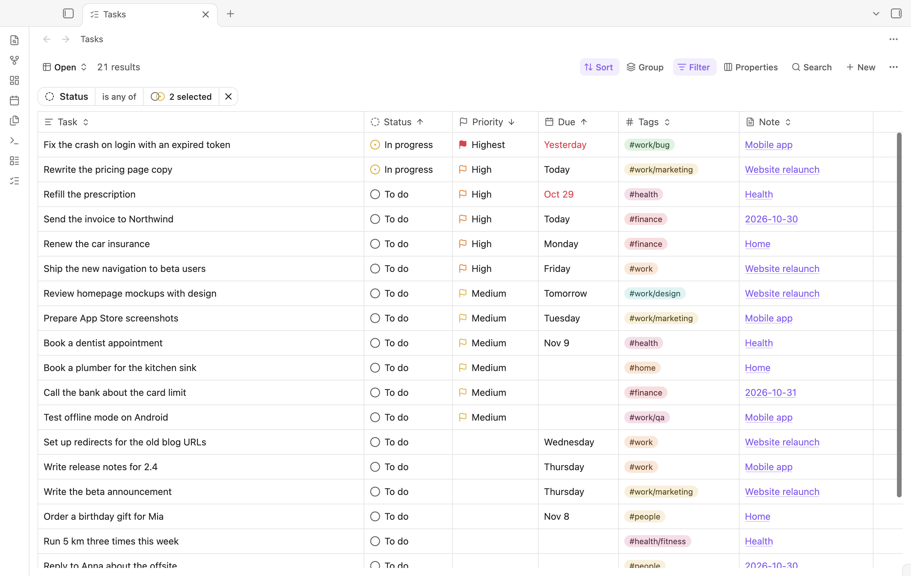

# Tasks Table

Tasks Table shows the tasks from every note in your vault in one table, in the style of Obsidian Bases. Tasks stay in their notes; the table reads them and writes your edits back to the Markdown.



## What it does

- Indexes `- [ ]` tasks in every note, also in callouts and numbered lists. Fenced code and front matter are skipped.
- Reads the Obsidian Tasks emoji format (`📅 2026-11-02`, `⏫`) and the Dataview format (`[due:: 2026-11-02]`, `[priority:: high]`).
- Statuses: **To do** `[ ]`, **In progress** `[/]`, **Later** `[>]`, **Done** `[x]` and **Cancelled** `[-]`. **Later** is a task put off for now: it stays open, so a past due date still shows as overdue, and the **Open** view leaves it out. Other checkbox symbols read as **To do** and keep their symbol.
- Saved views with filters, sorting, visible properties, column order and widths. Views save as you change them, like Bases.
- **Sort**: several sort rules, reordered by dragging. Tags sort by the first tag, then the next ones; numbers in fields sort as numbers.
- **Filter**: status, priority, dates (overdue, today, next 7 days and more), tags (nested tags match), note, folder and daily note (tasks from any daily note, or from today's, tomorrow's, yesterday's or the last 7 days' notes). Date filters also take a day picked from a calendar with **Pick a date…**. Daily notes are the notes in the Daily notes folder whose names match its date format. **Level** keeps first-level tasks or subtasks, which are tasks inside another list item (a task or a bullet).
- **Group**: group the rows by status, priority, a date, tags, note, folder, level or a Dataview field, in either order, and optionally group each group again by a second property (**Add subgroup**). Each group has a header with its number of tasks; select it to close or open the group. Views keep the grouping and the closed groups. Tasks keep the view's sort inside their group.
- **Properties**: show, hide, move and resize columns.
- Dataview inline fields: every `[key:: value]` in your tasks, such as `[projekt:: Website]` or `[estimate:: 3]`, is a property you can show as a column, filter by (is, is not, is empty, is not empty, with the values your tasks use) and sort by. Field columns start hidden. Fields with columns of their own (`due`, `scheduled`, `start`, `created`, `completion`, `cancelled`, `priority`) stay in those columns, and `(key:: value)` fields, which Dataview shows without their key, are not included. Neither are comments, which have a column of their own.
- **Undo**: <kbd>Mod</kbd>+<kbd>Z</kbd> while the table has focus undoes the table's last change to a task, such as its status, priority, a date, its tags, its title or a new comment; press it again to undo the change before. The task's line goes back exactly as it was, completion date included. A line that changed in its note since is left as it is. Moving, cutting, deleting and adding tasks cannot be undone. In a text field, <kbd>Mod</kbd>+<kbd>Z</kbd> undoes typing.
- **Search** across task text, comments and note names (<kbd>Mod</kbd>+<kbd>F</kbd> while the table has focus).
- **New** (or <kbd>Mod</kbd>+<kbd>N</kbd> while the table has focus) adds a task to today's daily note or to a note you choose.
- Edit in place: change status (or turn on the optional **Checkbox** property to complete tasks with one click), priority and dates from their cells; select a title to edit it, with long titles wrapped so you see all of the text. From the row menu, cut a task with its subtasks to paste it into another note, or delete it.
- **Run ChatGPT Desktop** and **Run Claude Desktop** (row menu, on a computer): open a new chat in the ChatGPT desktop app, or a new Claude Code session in the Claude desktop app, with “Help me with this task”, the task's line and the full path of its note in the message. The message also asks the agent to add a comment to the task when it starts, with a link back to its chat, such as `[comment_2026-11-03 14:30:: Agent is running in codex://threads/01a1a0f1-…]`, so the **Comments** column shows which tasks an agent is on and opens its chat. The agent reads its chat's id from `CODEX_THREAD_ID` (ChatGPT) or `CLAUDE_CODE_HOST_SESSION_ID` (Claude). Claude's `claude://code/continue?session=…` link is the one the Claude app uses itself; Anthropic does not document it yet. The chat works in the folder from the settings; Claude asks you to confirm that folder each time. Neither app sends anything until you press <kbd>Enter</kbd>. The first time, Obsidian asks before it opens the `codex://` or `claude://` link; you can let it always open them.
- **Comments**: the Comments property shows the number of comments on a task. Select it to read them, the newest last, and to add one. A comment is saved in the task line as a Dataview field named with the local date and time it was written: `[comment_2026-11-01 14:30:: Called the vendor]`. A new comment goes after the task text and its earlier comments, before its dates, where the Tasks plugin still reads them. Comments are not part of the task title or its tags, so editing the title or the tags keeps them. Links in comments open from the popup: web pages, Obsidian links, and agent chats, which show as **ChatGPT** or **Claude**.
- Tags: each tag has its own color, one of the theme's accent colors, picked from its name. Select a Tags cell to add or remove tags: search the vault's tags (listed by name), or type a new name and press <kbd>Enter</kbd> (spaces become dashes). Drag a tag to change the order, or press <kbd>Alt</kbd>+<kbd>←</kbd> or <kbd>Alt</kbd>+<kbd>→</kbd> on it. The note changes once, when you close the editor. New tags go after the task text, before its dates and fields; removed tags are taken out wherever they are in the text; reordered tags swap places, so the words around them stay.
- Changing a start date moves the task, with its subtasks and notes, to that day's daily note. The daily note is created from the Daily notes template when it does not exist. The task is added there first and removed from its old note after that, so a failed write never loses it.
- Select a note name to open the note at the task's line. <kbd>Mod</kbd>-select opens it to the right.
- Follows the Obsidian theme: colors, accent, light or dark mode, and the text font of your notes. Scroll bars show and hide as your system's scroll bars do (**System Settings → Appearance → Show scroll bars** on macOS).

Open the table with the ribbon icon or the **Tasks Table: Open table** command. The plugin also adds **Add task** and **Rebuild task index** commands.

## Settings

**Settings → Tasks Table**:

- **Add new tasks to**: today's daily note (uses the folder, date format and template of the Daily notes core plugin) or a specific note, optionally under a heading.
- **Write dates and priority as**: Tasks emoji or Dataview. On the first start the plugin uses the format of the Obsidian Tasks plugin, if you have it.
- **Add completion dates** and **Add created dates**.
- **Move tasks to the daily note of their start date** (on by default). Moved tasks go under the **Under heading** section of the daily note.
- **Folder for new chats** (on a computer): the folder, as a full path, that a chat from **Run ChatGPT Desktop** or **Run Claude Desktop** works in. Empty means the vault folder.
- **Task index**: the number of indexed tasks and a **Rebuild index** button.

## Data

- Settings and views are stored in an SQLite database, `tasks-table.sqlite`, in the plugin folder (`<vault>/.obsidian/plugins/tasks-table/`). It has a `settings` table with one `name`/`value` row per setting and a `views` table. It syncs with the rest of the vault's configuration.
- Tasks are not stored. The plugin builds an in-memory index from the notes when Obsidian starts and keeps it current from Obsidian's file events. Like the Tasks plugin, it uses Obsidian's metadata cache to skip notes without tasks. On a vault with 3,000 notes and 15,000 tasks, indexing takes about 0.4 seconds.
- The plugin works offline. It makes no network requests and sends no data anywhere. Only when you choose **Run ChatGPT Desktop** or **Run Claude Desktop**, it gives the task's line and the note's path to that desktop app, which puts them in a new chat's message.
- `main.js` contains sql.js's WebAssembly binary (SQLite), stored as base64 and decoded when the plugin loads. The sql.js loader also has code that downloads the `.wasm` file with `fetch` or `XMLHttpRequest`; the plugin never runs it, as it gives sql.js the bundled binary. Other `fetch` names in `main.js` are TanStack Query methods, not network requests.
- The plugin reads every Markdown file that has tasks, to index them, and writes to the system clipboard only when you copy table cells or cut a task.

Requires Obsidian 1.13 or later, on desktop and mobile.

## Development

```bash
npm install
npm run dev        # rebuild main.js and styles.css on every change
npm run build      # type check and production build
npm test           # unit tests (Vitest)
npm run lint       # ESLint with the Obsidian rules
npm run test:e2e   # build, then drive a real Obsidian through the main flows
npm run screenshot # build, then take docs/screenshot.png from a demo vault
```

`npm run test:e2e` starts a separate Obsidian (`/Applications/Obsidian.app` by default, override with `OBSIDIAN_PATH`) with a temporary profile and a generated fixture vault, so it never touches your own vaults. It copies the newest Obsidian app update from your profile, so the test runs the Obsidian version you use. It runs in the background: on macOS it starts Obsidian with `open -g`, and when Obsidian still takes the focus as it shows its window at start (Electron activates the app for each window it shows), it gives the focus back to the app you use within a moment. `npm run e2e:open` opens such an instance with a fixture vault and keeps it running (pass a vault path to use a copy of a vault instead; the plugin is installed into it; set `E2E_FOCUS=1` to work in it by hand); `PORT=9333 node e2e/cdp.mjs script.mjs` runs a Playwright script against it. `npm run screenshot` starts Obsidian the same way, with the demo vault from `e2e/fixtureVault.mjs` in the light theme.

To try the plugin in a vault, copy or link `main.js`, `manifest.json` and `styles.css` to `<vault>/.obsidian/plugins/tasks-table/`.

### How it is built

- `src/main.ts`: plugin lifecycle, commands and the view.
- `src/plugin/`: the composition root (`PluginServices`), the API the UI calls, the item view and the settings tab (Obsidian's declarative settings).
- `src/database/`: sql.js (SQLite compiled to WebAssembly, bundled into `main.js`), migrations, and the settings and views repositories.
- `scripts/reactDomScripts.mjs`: removes React DOM's script loading (`ReactDOM.preinit()` and hoisted `<script>` elements, which the plugin does not use) from the bundle, so `main.js` has no code that adds scripts to the page.
- `src/vault/`: task line syntax (`taskLineSyntax.ts`) and editing (`taskLine.ts`), the in-memory task index with its filters and sorting, the vault indexer and the writer that edits notes with `Vault.process`.
- `src/ui/`: the React UI with shadcn/ui (Base UI) and ReUI's data grid and filters, TanStack Table, Query and Store.

The UI uses Tailwind CSS. Obsidian loads `styles.css` into the whole app, so `scripts/scopeCss.mjs` scopes every rule to the plugin's elements, removes cascade layers and prefixes keyframes, and `src/ui/styles/obsidianReset.css` drops Obsidian's global button and input styles inside the plugin. The design tokens in `src/ui/styles/app.css` map to Obsidian's CSS variables. `src/ui/components/ui` and `src/ui/components/reui` are generated by the shadcn and ReUI registries; keep changes to them minimal. They follow the same lint rules as the rest of the code, as the community plugin review scans all of the source.

## Releasing

Bump `version` in `manifest.json` and `versions.json`, then create a GitHub release whose tag is the version. The release workflow builds and attaches `main.js`, `manifest.json` and `styles.css`.
